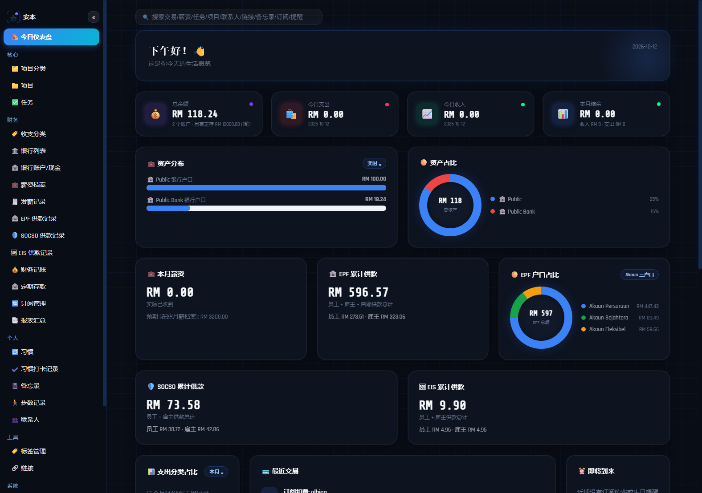
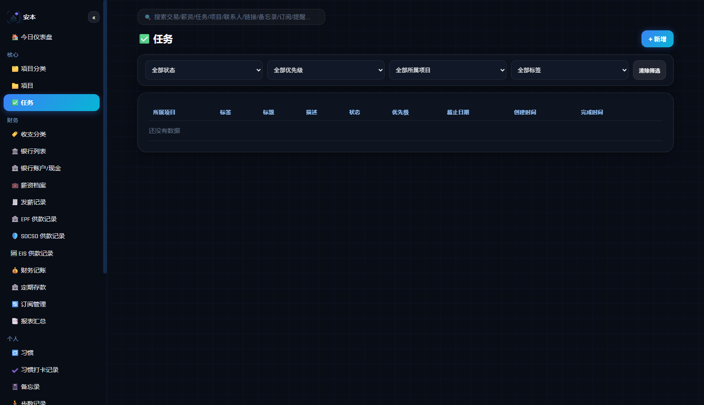
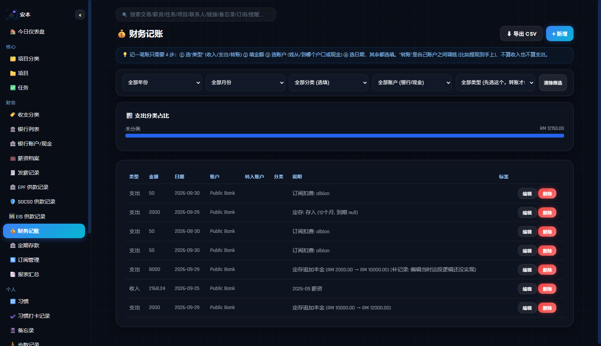
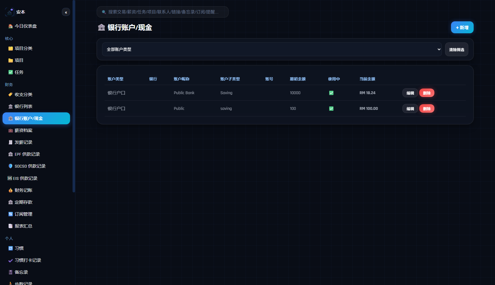
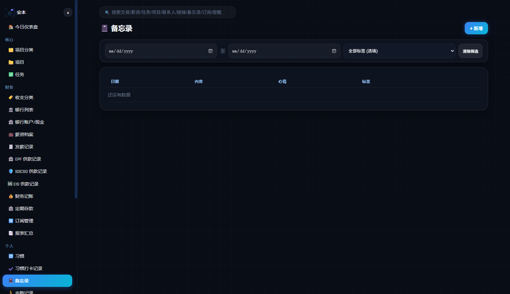

# Anben (安本)

A **current-state manual** for future-you, or whichever AI picks this project up next. Read this one file — don't treat the old changelog as the current state.

- Public product name: **Anben** (no longer called "Personal Life OS / 个人系统")
- Website: `C:\xampp\htdocs\personal_os\`
- App: `C:\Users\whb user\personasystem\` (short path `C:\Users\WHBUSE~1\personasystem`)
- Long-form history (v1–v4): `project_personal_life_os.md` — **outdated**, only open it to see "why it was designed this way back then"; don't copy its login flow / architecture into new code.
- 中文版: [`README.md`](README.md) (same content as this file)

Last major update: **2026-10-12**.

---

## 0. Screenshots

| Today's Dashboard | Tasks (with auto created/completed timestamps) |
|---|---|
|  |  |

| Transactions | Bank Accounts (delete protection) |
|---|---|
|  |  |

| Memos (formerly "Journal") |
|---|
|  |

---

## 0.1 Summary of the 2026-10-12 update round

- **Full UI redesign (v6.0)**: based on a design reference the user provided, the primary color moved from a single neon-cyan to a blue→cyan gradient plus distinct colors per module, corner radii were substantially increased for a softer look, and the dashboard header became a glassy, glow-lit welcome banner. Pure CSS change (`css/style.css`); no functional logic touched.
- **Fixed a background-service login race condition**: the app's background step-tracking/reminder service and the main app each independently auto-refresh their login token, and the two occasionally raced each other, which could force the user to log in again. Fixed by having the background service piggyback on its already-reliable 30-second heartbeat to check and refresh its own session, which greatly reduces the odds of a collision (`step_service.dart`).
- **Tasks now auto-record "created at" / "completed at"**: `tasks.created_at` / `completed_at`. The completion timestamp is stamped only when status actually transitions to "done", and cleared when reverted to "not done"; editing unrelated fields (title, description, etc.) never touches it.
- **Tags became module-scoped**: tags on reminders/memos/contacts moved from free-text to the same dropdown-selection pattern already used for tasks/finance (scoped by `tags.module`). This also surfaced and fixed two real bugs — the app's and the website's own independent instances of "`fk_filter` never applied" and "`fkCache` never invalidated".
- **"日记" (Journal) renamed to "备忘录" (Memo)**: a display-name/copy-only change; the underlying table name `journal_entries` is unchanged. Also fixed the memo list display (missing `white-space: pre-wrap`, which collapsed existing paragraph breaks), and the app now shows a read-only preview first, only entering edit mode when you tap "Edit".
- **Bank account delete protection**: deleting an account with linked salary payment records now shows an explicit warning ("this will permanently delete N linked salary records, including their EPF/SOCSO/EIS contribution records and auto-generated transactions") before cascading, instead of surfacing a raw database foreign-key error.
- **Timezone display fixes**: several datetime fields in the website's list views and the app's edit forms were missing `.toLocal()` conversion, showing times 8 hours off; fixed as part of this same round.

**After editing `config_resources.php` you must regenerate `config_resources.json`** (one copy for the website, one copy in the App's `assets/`) for anything to actually take effect — editing the `.php` file alone changes nothing. This tripped us up once this round; see Section 7 for the exact steps.

---

## 1. Current architecture

```
Browser  →  index.html + js/app.js + js/supabase_bridge.js  ──┐
                                                                ▼
Mobile App →  Flutter (api_service.dart + supabase_bridge.dart) →  Supabase
                                                                (Postgres + Auth + RLS)
```

There is no custom PHP backend. `api.php` / `db.php` are dead code, kept only for reference; `config_resources.php` is **not** dead code — it's still the real source of configuration, it's just never executed live by a server. After editing it you must manually run a PHP CLI step to regenerate `config_resources.json` (the website/App actually read that JSON file) — see Section 7. The real business logic lives in the two bridge files (`js/supabase_bridge.js` / `lib/supabase_bridge.dart`), which must be **kept in sync by hand** (editing the JS does not automatically update the Dart).

Data isolation relies on **RLS** (`auth.uid() = user_id`). The frontend only ever holds the **anon key** — never put the `service_role` key in client code. Admin-only exceptions go through `public.is_admin()`.

Website copy should never say "shared by multiple people / you only see your own stuff" — technically it's still multi-account + RLS under the hood.

---

## 2. Feature overview (what users actually interact with)

Tasks (with auto-recorded created/completed times) / Projects / Habit check-ins / Memos (formerly "Journal") / Inbox / Contacts (birthday reminders) / Links / Tags (scoped per module) / Expense categories / Banks & cash accounts (delete-protected) / Transactions (income, expense, transfer; balances computed live) / Dynamic salary + EPF's 3 sub-accounts / SOCSO, EIS / Subscription renewal reminders / Fixed deposits / Weekly/monthly/yearly reports / General-purpose reminders / Global search / Step count (App only) / Local notifications (App only)

**Accounts:**

- Sign-up: name + real email + password → **must enter the full numeric verification code from the email** on the website/App to complete (usually 8 digits — don't stop at 6)
- Sign-in: email + password (accounts that haven't completed email verification cannot sign in)
- Forgot password: self-service, via a fresh verification code — there is **no** admin "reset to 123456" option
- The UI shows the **display name**, never the email; the email is only visible to admins, in "User Management"
- Legacy username sign-in: the bridge layer may still convert a bare (non-`@`) identifier into `xxx@personalos.local` for legacy accounts

**Admin "User Management":** edit name / email / role; deleting a user wipes their business data + `profiles` + **`auth.users`** (the email becomes available for re-registration). You cannot delete yourself, and at least one admin must remain.

**Backup:**

- Regular user: "Export my data" = an INSERT dump of the current account's business tables
- Admin: "Export full database backup" calls the `admin_export_full_sql()` RPC — every public table plus `auth.users` / `auth.identities` (including password hashes). **Does not include** `CREATE TABLE` / RLS / functions. To migrate: run `个人系统_schema_supabase.sql` first, then this SQL dump. Treat the exported file as a secret.

---

## 3. File map

```
C:\xampp\htdocs\personal_os\
  index.html                 Login + app shell; script ?v= must be bumped
  css/style.css               Dark glassmorphism theme
  js/app.js                   All UI logic
  js/supabase_bridge.js       Website "backend" (Auth / CRUD / dashboard / backup)
  img/                        Product icons (from the user's SVG)
  screenshots/                Screenshots used by this README
  config_resources.json       The resource config actually read by the website/App (see Section 7)
  个人系统_schema_supabase.sql Reference schema + RLS (may lag slightly behind the live DB)
  README.md                   This file, in Chinese (the current state)
  README.en.md                The English version of this file
  project_personal_life_os.md Historical changelog
  anben-app.apk                Latest packaged App install file (for installing updates / handing to testers)
  anben_app_source.zip         Full App source code archive (for whoever picks up App development next)

C:\Users\whb user\personasystem\
  lib/main.dart, api_service.dart, supabase_bridge.dart, screens/, step_service.dart
  assets/logo.png, assets/config_resources.json
  android/.../ic_launcher*     Desktop icon
```

Current website cache-busting versions (bump by one whenever you edit the JS/CSS): `supabase_bridge.js?v=22`, `app.js?v=20261012b`, `style.css?v=20261012c`.

---

## 4. Login / Email (state as of 2026-10)

### 4.1 Product flow

1. `signUp` only sends an OTP; even if it returns a session, the client immediately calls `signOut`
2. `verifyOtp` with `type=signup` only writes the profile and enters the app once it succeeds
3. Sign-in is rejected if the email isn't confirmed
4. Forgot password: `resetPasswordForEmail` + `verifyOtp` with `type=recovery` + `updateUser({password})`

Email templates must include `{{ .Token }}`. **Do not put a clickable confirmation link in the "Confirm signup" / "Reset password" templates** — clicking the link would bypass the "must type the OTP on the page" requirement.

### 4.2 Required Dashboard settings

- Authentication → Email → **Confirm email = ON** (`mailer_autoconfirm: false`)
- **Custom SMTP = ON**, currently Brevo:

```
Host:     smtp-relay.brevo.com
Port:     587
Username: use whatever Brevo's "SMTP settings → Login" currently shows (it once changed from bc2b62001 to bc2c82001 — a mismatch causes a 535 error)
Password: the Standard SMTP key (xsmtpsib-…, not the 15-char Short key, not an xkeysib- API key)
Sender:   must be a Verified sender in Brevo
          (currently leeyongjun1218@e.newera.edu.my)
Sender name: 安本
```

Do not enable Brevo's "Block unauthorized IP for SMTP keys".

Common causes of send failures: Username doesn't match the Brevo Login, SMTP key auth failure, Sender not verified. The real sign-up email is only sent once Confirm email is turned on.

### 4.3 Related database objects

- `handle_new_user()`: writes `profiles` (display_name / email / role) after sign-up — **no longer** sets `must_change_password`
- `admin_update_user_email(uuid, text)`
- `admin_delete_auth_user(uuid)`: deletes `auth.identities` + `auth.users`
- `admin_export_full_sql()`: full data SQL dump (admin only)
- **Removed:** `admin_reset_user_password`, `profiles.must_change_password`

If an admin deletes a user and the email still shows as "already registered," it's usually an orphaned `auth.users` row left over by an old bug. The app now calls the RPC to delete the Auth record too, so this shouldn't recur.

---

## 5. Admin & RLS (already live — re-add this if you ever start a new project)

```sql
CREATE OR REPLACE FUNCTION public.is_admin() RETURNS boolean
LANGUAGE sql SECURITY DEFINER STABLE
AS $$
  SELECT COALESCE((SELECT role = 'admin' FROM public.profiles WHERE id = auth.uid()), false);
$$;
```

`profiles`: everyone can see their own row; admins can SELECT/INSERT/UPDATE/DELETE every row.
Business tables with a `user_id` column: users see their own rows; admins can read all of them (needed for full-database backup).
**Business list queries must still filter by `.eq('user_id', current user)`**, even for admins — otherwise an admin would see other people's data inside ordinary modules. Other people's data should only ever surface inside "User Management".

The frontend must **never** use the `service_role` key. To create an admin account: have the person register normally, then change their `profiles.role` afterward.

---

## 6. Migration / backup

1. Run the latest schema (tables, RLS, functions — trust the live database over the schema file) on the new Supabase project
2. Configure SMTP + Confirm email + the email template tokens
3. As an admin, download the full-database SQL dump — schema first, then data
4. Also back up the website + App source code and `config_resources.json`
5. SMTP / Brevo settings are not part of the SQL dump — note them down separately

The full-database SQL dump contains password hashes — **treat it as a secret**. It does not include the website UI.

---

## 7. Day-to-day feature changes

1. Changing a field: `config_resources.php` → regenerate `config_resources.json` → copy it into the App's `assets/` → bump the website's `?v=` → rebuild the App's APK

   The exact command to regenerate the JSON (PHP CLI; `$config` comes from the `return $config;` at the end of the file — the JSON's top level **is** that map directly, **do not** wrap it in `{ok, resources}`):
   ```php
   <?php
   $config = require "C:\\xampp\\htdocs\\personal_os\\config_resources.php";
   file_put_contents("C:\\xampp\\htdocs\\personal_os\\config_resources.json", json_encode($config, JSON_UNESCAPED_UNICODE | JSON_PRETTY_PRINT));
   ```
   Afterwards, remember to `Copy-Item config_resources.json` into the App's `assets\config_resources.json` and rebuild the APK — otherwise the App's forms/dropdowns keep using the stale config. **If you skip this step after editing only the `.php` file, neither the website nor the App will show any change at all** — this genuinely tripped us up once during the 2026-10-12 round.

2. New table: create it in Supabase + RLS + admin policy + the PHP config entry + any special-case logic in both bridge files
3. Website: the local `C:\xampp\htdocs\personal_os` folder may auto-sync to InfinityFree. URL: `https://personalos.infinityfree.me`
4. App:

```
cd /d C:\Users\WHBUSE~1\personasystem
flutter build apk --release
flutter install -d <device-id>
```

The test device used so far: `10AG2S0S2U001S0` (a V2553). If a JS change "doesn't show up," 99% of the time it's because `index.html`'s `?v=` wasn't bumped.

---

## 8. Known limitations

- Website reminders are not a true 24-hour background process; the App has a foreground step-tracking service plus a check-on-open sync — this is not medical-grade step counting
- The full-database backup doesn't include the schema; the schema file may lag behind the live database
- Clicking an email's magic link can still confirm the email address — this is mitigated by removing the link from the template
- Re-registering an unverified email can sometimes return empty identities from Supabase
- The `personal_os\personal_os\` subdirectory is an old copy — never edit it as if it were the production files
- InfinityFree can't run PHP connected to Postgres, and can't serve as the App's API either (Website Guard blocks it)

---

## 9. Connection details (for maintenance scripts only — never put these in the frontend)

- Project: `xpbtyfattbqsaasmokoy`
  `https://xpbtyfattbqsaasmokoy.supabase.co`
- anon key: top of `js/supabase_bridge.js` / the App's `main.dart` (safe to make public)
- Pooler: `aws-0-ap-southeast-2.pooler.supabase.com:6543`
  user `postgres.xpbtyfattbqsaasmokoy`, password in the local `Downloads\supabase password.txt`
  direct IPv6 connection doesn't work from this machine — you must use the pooler
- Local website: `http://localhost/personal_os/` (Apache: `C:\xampp\apache_start.bat`)
- PHP: `C:\php83\php.exe`

---

## 10. Hard rules for AI assistants

1. Keep the website and App functionally identical; when you change a bridge file, change both.
2. The sidebar/login screen must show the **display_name**, never use the email as the display nickname.
3. Ordinary CRUD must always filter by the current `user_id`, even for an admin user.
4. Never bring back a "reset password to 123456" admin feature.
5. Never change the product copy back to "shared by multiple people."
6. Never put the `service_role` key into JS/Dart.
7. Editing `app.js` / `supabase_bridge.js` / `style.css` requires bumping the version number in `index.html`.
8. Icons: the user's SVG → the website's `img/`, the App's `assets/logo.png`, and the Android mipmap folders.
9. **This README is the source of truth for the current state**; `project_personal_life_os.md` is archaeology only.
10. After editing `config_resources.php`, you must regenerate `config_resources.json` and copy it to both the website root and the App's `assets/` — otherwise the edit has no effect (see Section 7).
11. Whenever you update the Chinese README, update `README.en.md` to match — the two must stay in sync.
